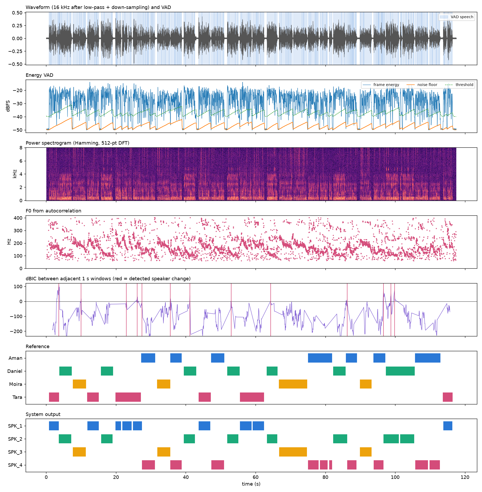

# Real-time Multi-speaker Diarization

Real-time speaker separation and identification (1–4 speakers, no overlapping speech) from a computer microphone,
using pure signal processing (numpy / scipy) with no neural network at all. Every time the speaker changes, the system
cuts the previous speaker's audio out as a cleaned `.wav` file (ready to hand to an ASR) and logs the timestamp + label to JSON.

## Installation

```bash
uv venv --python 3.12 .venv && uv pip install --python .venv/bin/python -r requirements.txt
```

(or `python3.12 -m venv .venv && .venv/bin/pip install -r requirements.txt`)

## Usage

**Real-time from the microphone**  (press Ctrl+C to stop)

```bash
.venv/bin/python main.py live --out runs/live
```

On macOS the first run requires granting Terminal microphone access (System Settings → Privacy & Security → Microphone).
List the available devices with `main.py devices` and pick one with `--device <index>`.

**From an audio file** (fed in 50 ms at a time like a real microphone, using the same code path), with evaluation and plots

```bash
.venv/bin/python main.py file data/test4.wav --ref data/test4.rttm --out runs/test4 --plot --refine
```

**Evaluate an existing result** (e.g. from a live recording whose reference was made afterwards)

```bash
.venv/bin/python main.py eval --ref my_reference.rttm --hyp runs/live/result.json
```

**Generate a test conversation with known ground truth** (macOS TTS voices as speakers, with noise + reverb)

```bash
.venv/bin/python tools/make_conversation.py --speakers 3 --turns 20 --out data/conv3
```

**Tune parameters** (grid search for the lowest DER), **hum robustness test** and **unit tests**

```bash
.venv/bin/python tools/tune.py data/conv2 data/conv3 data/conv4 --grid bic_lambda=1.5,1.7,1.9 clu_lambda=1.4,1.8,2.2
```

```bash
.venv/bin/python tools/hum_test.py data/test2 data/test3 data/test4 --snr 20 10 0
```

```bash
.venv/bin/python -m pytest tests
```

All parameters live in [diarize/config.py](diarize/config.py) and can be overridden from the command line, e.g.
`--set min_silence_s=0.4 bic_win_s=1.2`

**Web demo** (the same Python package running in the browser through Pyodide; microphone, sample conversations or an uploaded file)

```bash
python3 -m http.server 8765
```

then open `http://localhost:8765/web/`. The site is static, so it can be deployed as is (e.g. `vercel` from the
repository root; `vercel.json` maps `/` to `web/index.html`).

### Output

```
runs/<name>/
  result.json          # timestamp + label of every segment (item 2.2)
  result.rttm          # standard format for pyannote.metrics
  segments/0003_SPK_2_00012.40-00015.93.wav   # 1 file = 1 speaker, 16 kHz, cleaned
  eval.json, session.png, session_timeline.png   # when --ref / --plot is given
```

```json
{"id": 0, "speaker": 0, "label": "SPK_1", "start": 0.821, "end": 3.631, "duration": 2.81,
 "confidence": 1.0, "f0_hz": 189.4, "reason": "change", "emitted_at": 4.9, "latency_s": 1.278,
 "file": "segments/0000_SPK_1_00000.82-00003.63.wav"}
```

`reason` says why the segment was cut: `pause` (silence ≥ 0.3 s), `change` (ΔBIC detected a speaker change mid-speech),
`max` (longer than 20 s), `flush` (recording stopped)

## Pipeline (matches section 2.1 of the proposal)

```
mic 48 kHz ─► FIR low-pass 7.2 kHz ─► ↓3 ─► 16 kHz ─► NLMS canceller ─┬─► pre-emphasis ─► Butterworth BP 80–7000 ─► Hamming ─► DFT ─► |X|² ─► mel ─► MFCC ─┐
 (2.1.1)        (2.1.2)              (2.1.3)          (adaptive)      │     (2.1.4)          (2.1.5)                (2.1.6)  (2.1.7) (2.1.8)             │
                                                                      ├─► Butterworth BP 60–900 ─► Hamming ─► autocorrelation ─► F0 ────────────────────────┤
                                                                      │                                          (2.1.9)                                  │
                                                                      └─► Butterworth HP 70 ─► energy VAD ─► real-time window ◄── ΔBIC change detection ◄─┤
                                                                                                                  │                                       │
                                                                               clean (spectral subtraction) ◄─ cut segment ─► online BIC clustering ◄─────┘
                                                                                       │                                          (2.1.10)
                                                                                       ▼
                                                                               segments/*.wav + result.json
```

| Section | What it does | Code |
|---|---|---|
| 2.1.1 Sampling | Captures 48 kHz microphone audio in 50 ms blocks through a `sounddevice` callback | [main.py](main.py) `cmd_live` |
| 2.1.2 Low-pass | 97-tap FIR (Hamming window design) with a 7.2 kHz cutoff to prevent aliasing before the rate reduction | [dsp.py](diarize/dsp.py) `Decimator` |
| 2.1.3 Down sampling | Keeps every 3rd sample → 16 kHz (the phase is carried across blocks, so the result equals processing the whole file) | `Decimator.process` |
| Adaptive filtering | NLMS adaptive noise canceller (1024 taps, reference = the microphone delayed 30 ms); removes mains hum / fan tones before feature extraction | `AdaptiveNoiseCanceller` |
| 2.1.4 Pre-emphasis | `y[n] = x[n] − 0.97 x[n−1]` boosts high frequencies so the formants stand out | `PreEmphasis` |
| 2.1.5 IIR Butterworth | 4th order in SOS form with continuous state; three are used: speech band, pitch band, and a high-pass for audio files | `Butterworth` |
| 2.1.6 Windowing | Hamming 32 ms, hop 10 ms | `hamming`, `frame_signal` |
| 2.1.7 DFT | 512-point FFT (a direct-definition O(N²) `dft()` is kept to verify they match) | `dft`, `power_spectrum` |
| 2.1.8 Power spectrum + Spectrogram | `|X[k]|²/N` → 26-channel mel filterbank → log → DCT → MFCC c1–c12 | `power_spectrum`, `spectrogram`, `mfcc_from_power` |
| 2.1.9 Autocorrelation | Wiener–Khinchin `r = IDFT{|X|²}` (zero-padded to ≥ 2N−1 so it is a linear correlation) + center clipping → F0 | `autocorrelation`, `pitch_autocorr` |
| 2.1.10 Clustering | Per-speaker Gaussian of MFCC + log-F0, decided by ΔBIC (online) and agglomerative BIC (offline, for comparison) | [cluster.py](diarize/cluster.py), [gauss.py](diarize/gauss.py) |

### Building the real-time cutting window ([pipeline.py](diarize/pipeline.py))

A state machine runs every 10 ms:

1. **VAD** – frame energy against a self-adapting noise floor (falls fast, rises slowly); more than 10 dB above it = speech
2. **Cut at a pause** – silence ≥ 0.3 s → close the segment and emit it immediately (delay ≈ 0.35 s)
3. **Cut mid-speech** – some speakers follow each other with no gap, so two adjacent 1 s windows are compared with
   ΔBIC = ½[N log|Σ| − N₁ log|Σ₁| − N₂ log|Σ₂|] − λP; if ΔBIC > 0 and the peak is 0.25 s behind
   → cut at the peak (delay ≈ 1.3 s)
4. A closed segment goes to **clustering** → gets a label → **cleaner** (spectral subtraction using a noise print
   from the most recent silence, trim head and tail, normalize to −20 dBFS, fade) → file + JSON written immediately

### Adaptive noise canceller ([dsp.py](diarize/dsp.py) `AdaptiveNoiseCanceller`)

Same structure as an acoustic echo canceller, but a single microphone has no separate reference signal, so the
reference is the microphone itself delayed by D = 30 ms (an adaptive line enhancer):

```
d(n) = v(n) + y(n)        microphone = speech + periodic interference (hum, fan)
x(n) = d(n − D)           reference
ŷ(n) = ĥᵀ x(n)            adaptive FIR estimate of the interference
e(n) = d(n) − ŷ(n)        output, goes on to the three feature branches
ĥ ← ĥ + μ e(n) x(n) / (‖x(n)‖² + L e(n)²)        NLMS, μ = 0.005, L = 1024
```

A periodic interference can be predicted from 30 ms ago, so it is subtracted. Voiced speech and reverberation are
also partly predictable over 30 ms, so the weights are only updated while the output level is within 6 dB of its
noise floor (i.e. nobody is talking), the same reason an echo canceller freezes during double-talk. Set
`--set anc_taps=0` to switch the stage off.

### Clustering

Each speaker is a full-covariance Gaussian of MFCC + a 1-D Gaussian of log-F0 (sufficient statistics are accumulated,
so updating/merging is fast). A new segment joins the speaker with the lowest ΔBIC if ΔBIC < 0; otherwise a new speaker
is opened (at most 4), provided there is ≥ 1.5 s of speech (a covariance from a short segment is unreliable and
creates spurious speakers). If two speaker models become similar (ΔBIC < 0) they are merged into one.

## Experimental results (item 4)

Conversations synthesized from macOS TTS voices (~100 s, 20–24 turns, 30% of speaker changes have a gap < 0.15 s,
with noise + room reverb) — the `conv*` set was used for parameter tuning; the `test*` set uses different voices and was not used for tuning
(DER uses a 0.25 s collar, F1 = per-speaker macro F1 after optimal mapping, 10 ms frames)

| File | Speakers | SNR / RT60 | DER | Speaker F1 | Speakers found | Mean / max delay |
|---|---|---|---|---|---|---|
| conv2 | 2 | 30 dB / 0.2 s | 1.8 % | 97.9 % | 2 | 0.94 / 1.32 s |
| conv3 | 3 | 30 dB / 0.2 s | 3.8 % | 94.5 % | 3 | 1.08 / 1.32 s |
| conv4 | 4 | 30 dB / 0.2 s | 3.6 % | 95.5 % | 4 | 1.03 / 1.32 s |
| **test2** | 2 | 30 dB / 0.2 s | **5.8 %** | **93.5 %** | 2 | 0.97 / 1.32 s |
| **test3** | 3 | 25 dB / 0.2 s | **5.8 %** | **93.7 %** | 3 | 0.82 / 1.32 s |
| **test4** | 4 | 20 dB / 0.3 s | **4.6 %** | **95.9 %** | 4 | 0.69 / 1.32 s |

- **Time delay** is at most 1.32 s on every file (target 1–2 s) — pause cuts ~0.35 s, ΔBIC cuts ~1.3 s
- Processing runs ~16× faster than real time (real-time factor 0.06 on a MacBook; 0.015 with the adaptive canceller off)
- Against offline re-clustering (`--refine`) the online system is better on conv2, conv3 and test2 (offline finds
  too many speakers there), worse on conv4 and test3, and equal on test4

**Mains hum** (50 Hz + harmonics to 600 Hz added to the same six files, `tools/hum_test.py`), mean DER:

| Speech-to-hum ratio | Canceller off | Canceller on |
|---|---|---|
| no hum | 4.1 % | 4.2 % |
| 20 dB | 11.9 % | 4.1 % |
| 10 dB | 34.2 % | 7.7 % |
| 0 dB | 98.8 % | 16.8 % |

Without hum the canceller changes nothing on five files and costs 0.7 points on test4.



**Real meetings** (AMI corpus, headset mix, 4 speakers, 14–25 min, 5–16 % of speech overlapped; default parameters):

| Meeting | DER | miss / false alarm / confusion | Speaker F1 | DER if everything is labelled as one speaker |
|---|---|---|---|---|
| ES2004a | 74.3 % | 27.1 / 7.7 / 39.4 | 22.4 % | 56.2 % |
| IS1009a | 48.1 % | 19.2 / 7.1 / 21.8 | 42.0 % | 38.6 % |
| TS3003a | 61.1 % | 42.0 / 0.9 / 18.1 | 18.9 % | 14.1 % |

On real meetings the system is no better than labelling all speech as one speaker (the last column assumes perfect
speech detection). Turns are short (median ≈ 1 s, below the 1.5 s needed to open a new speaker), quiet speakers are
missed by the energy VAD, and a small grid over `bic_lambda` / `clu_lambda` did not help.

## Limitations / future work

- The numbers above come from TTS voices, where each "person" has a very stable voice. For real people in a room, record
  real audio (`main.py live` keeps a `recording.wav`), make a reference RTTM, then use `tools/tune.py` to re-tune
  `bic_lambda`, `clu_lambda`, `min_silence_s` — the BIC λ has the largest effect
- Early in a meeting, a speaker who talks for less than 1.5 s is not yet split off as a new speaker (they are assigned to the nearest one)
- Labels that have already been emitted cannot be changed (it is real-time); if two models are merged later, new labels are correct but old ones stay as they were
- The adaptive canceller only removes steady periodic interference (hum, fan tones) and has only been tested on
  synthetic hum; it does nothing for broadband noise, and after a sudden change in the interference it needs a
  pause in the speech to re-converge
- Per scope 1.3.2, the system does not support overlapping speech
