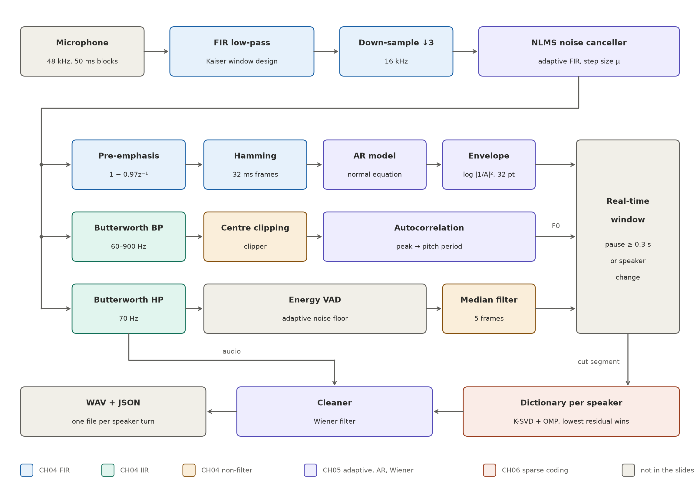

# Real-time Speaker Diarization using Signal Processing

**Who spoke when, live from one microphone — using only signal processing.** The system listens to a conversation of
1–4 people, cuts the audio into speaker turns as they happen, labels each turn (`SPK_1`, `SPK_2`, …) and writes every
turn out as a cleaned `.wav` plus a JSON log, ready to hand to a speech recognizer. 

**Live demo:** <https://multi-speaker-classification-using.vercel.app> (the same Python package, running in the
browser through Pyodide)



| | Synthetic test set | CALLHOME (phone calls) | AMI (meetings) |
|---|---|---|---|
| **DER** (lower is better) | **16.9 %** | 34.9 % | 68.3 % |
| Speaker F1 | 80.7 % | 42.9 % | 27.5 % |
| Max delay after a turn ends | 1.38 s | 1.54 s | 1.43 s |


Course project for *01204496 Algorithmic-Oriented Digital Signal Processing*, Kasetsart University.

---

## Contents

- [Quick start](#quick-start)
- [How it works](#how-it-works)
- [Data and evaluation](#data-and-evaluation)
- [Experiments](#experiments)
- [Repository layout](#repository-layout)
- [Limitations](#limitations)

## Quick start

```bash
python3.12 -m venv .venv && .venv/bin/pip install -r requirements.txt
```

**Live from the microphone** (Ctrl+C to stop). On macOS, allow Terminal to use the microphone the first time.
`main.py devices` lists the input devices; pick one with `--device <index>`.

```bash
python main.py live --out runs/live
```

**From a file**, fed in 50 ms blocks like a real microphone (same code path), with evaluation and plots:

```bash
python main.py file data/test4.wav --ref data/test4.rttm --out runs/test4 --plot
```

**Web demo locally** (microphone, sample conversations or an uploaded file), then open `http://localhost:8765/web/`:

```bash
python3 web/serve.py
```

All parameters live in [diarize/config.py](diarize/config.py) and can be overridden with
`--set name=value`, e.g. `--set min_silence_s=0.4 dict_change_thr=0.4`.

### Output

```
runs/<name>/
  result.json                                  # one entry per speaker turn
  result.rttm                                  # standard format, for pyannote.metrics
  segments/0003_SPK_2_00012.40-00015.93.wav    # one file per turn, 16 kHz, cleaned
  eval.json, session.png, session_timeline.png # with --ref / --plot
```

```json
{"id": 0, "speaker": 0, "label": "SPK_1", "start": 0.821, "end": 3.631, "duration": 2.81,
 "confidence": 1.0, "f0_hz": 189.4, "reason": "change", "emitted_at": 4.9, "latency_s": 1.278,
 "file": "segments/0000_SPK_1_00000.82-00003.63.wav"}
```

`reason` is why the turn was cut: `pause` (silence ≥ 0.3 s), `change` (speaker change mid-speech), `max` (longer
than 20 s) or `flush` (recording stopped).

## How it works

Audio arrives at 48 kHz in 50 ms blocks and goes through four stages. The colors in the diagram above show which
chapter of the course each block comes from.

| Stage | Block | What it does | Course | Code |
|---|---|---|---|---|
| **1 · Preprocessing** | FIR low-pass | Kaiser-window design: passband 6.8 kHz, stopband 8 kHz, δ = 0.001 → A = 60 dB, β = 5.65, 147 taps (linear phase); stops aliasing before down-sampling | CH04-03 | [dsp.py](diarize/dsp.py) `kaiser_lowpass` |
| | Down-sample ↓3 | Keeps every 3rd sample → 16 kHz (phase carried across blocks) | CH03-01 | `Decimator` |
| | NLMS canceller | Adaptive FIR, 1024 taps, that predicts and subtracts periodic noise (mains hum, fans) | CH05-02, CH05-03 | `AdaptiveNoiseCanceller` |
| **2 · Feature extraction** | 2.1 Spectrum | Pre-emphasis `1 − 0.97 z⁻¹` → Hamming 32 ms / hop 10 ms → autocorrelation r[0..16] → normal equations R a = r → log envelope −log\|A(e^jω)\|² at 32 points: the shape of the vocal tract | CH04-03, CH05-01, CH05-02 | [sparse.py](diarize/sparse.py) `envelope`, [ar.py](diarize/ar.py) |
| | 2.2 Pitch (F0) | Butterworth band-pass 60–900 Hz → center clipping (30 % of peak) → autocorrelation peak in lag 40…266 → F0 = fs / k* | CH04-02, CH04-03, CH02-03 | [dsp.py](diarize/dsp.py) `pitch_autocorr` |
| | 2.3 VAD | Butterworth high-pass 70 Hz → frame energy vs. a self-adapting noise floor (+10 dB) → 5-frame median filter | CH04-02, CH04-03 | [vad.py](diarize/vad.py) |
| **3 · Segmentation** | Real-time window | Cuts a turn at a pause ≥ 0.3 s, or mid-speech when the speaker changes (checked every 50 ms) | – | [pipeline.py](diarize/pipeline.py) |
| **4 · Speaker ID & output** | Dictionary per speaker | 16 envelope atoms per speaker learned with K-SVD; a turn is coded with OMP and goes to the speaker whose dictionary leaves the smallest residual | CH06-01 | [sparse.py](diarize/sparse.py), [cluster.py](diarize/cluster.py) |
| | Cleaner | Wiener gain S / (S + N) per frequency, noise from the latest silence | CH05-02 | [cleaner.py](diarize/cleaner.py) |
| | Writer | One `.wav` per turn + JSON / RTTM | – | [io.py](diarize/io.py) |

Spectrum (2.1) and pitch (2.2) both describe *who* is speaking — the shape of the vocal tract and how fast the vocal
folds vibrate — and feed the speaker model and the change detector together. VAD (2.3) only says *whether* anyone is
speaking, for segmentation.

<details>
<summary><b>NLMS noise canceller</b></summary>

A single microphone has no separate noise reference, so the reference is the microphone itself delayed by
D = 30 ms (an adaptive line enhancer). Periodic interference is still correlated after 30 ms and can be predicted;
speech mostly is not.

```
d(n) = v(n) + y(n)        microphone = speech + periodic interference
x(n) = d(n − D)           reference
ŷ(n) = ĥᵀ x(n)            adaptive FIR estimate of the interference
e(n) = d(n) − ŷ(n)        output
ĥ ← ĥ + μ e(n) x(n) / (‖x(n)‖² + L e(n)²)        NLMS, μ = 0.005, L = 1024
```

Voiced speech is also partly predictable over 30 ms, so the weights are only updated while the output is within 6 dB
of its noise floor (nobody talking), like an echo canceller freezing during double-talk. `--set anc_taps=0` switches
it off.
</details>

<details>
<summary><b>Speaker model: sparse coding with a learned dictionary</b></summary>

Each 10 ms frame becomes the 32-point log envelope of its AR(16) model, mean removed. A speaker is a dictionary D of
16 envelope shapes ("atoms") learned from that speaker's own frames with **K-SVD**: alternate (1) sparse coding of
every frame with **OMP** and (2) updating each atom as the best rank-1 fit (SVD) of the error of the frames that use
it. A frame x is coded with one atom, and the share of its energy left over,

```
residual = Σ‖x − D α‖² / Σ‖x‖²        (0 = perfectly explained, 1 = not at all)
```

says how well the turn fits that speaker. The distance to a speaker is the residual plus
0.5 × |difference of mean log-F0|. The closest speaker wins if the distance is below 0.21; otherwise a new speaker
is opened (at most 4, and only with ≥ 1.5 s of speech). Two speakers closer than 0.17 are merged. Each speaker keeps
its latest 2000 frames (20 s) and its dictionary is re-learned when frames arrive.

A dictionary keeps several shapes per person (vowels, consonants) where one AR model keeps a single average: with the
true turn boundaries, 1 s pieces of speech go to the right speaker 95.5 % of the time against 91.1 %.
</details>

<details>
<summary><b>Real-time segmentation</b></summary>

A state machine runs every 10 ms:

1. **Pause** — VAD silence ≥ 0.3 s closes the turn and emits it at once (delay ≈ 0.35 s).
2. **Change between known speakers** — every 50 ms the last 1 s is coded with every speaker's dictionary; the winner
   is median-filtered over 9 checks and the turn is cut where it changes (delay ≈ 0.8 s).
3. **Change to an unknown speaker** — a small dictionary (8 atoms) is learned on each of two adjacent 1 s windows; if
   each codes the other clearly worse than itself (plus the jump in mean log-F0), the score passes 0.36 and the turn is
   cut at the peak (delay ≈ 1.3 s).
4. A closed turn goes to speaker ID → cleaner (Wiener filter, trim, normalize to −20 dBFS, fade) → written to disk.
</details>

## Data and evaluation

| Set | What | Used for |
|---|---|---|
| Synthetic | Conversations made from macOS TTS voices, ~100 s each, 20–24 turns, white Gaussian noise + room reverb, 30 % of speaker changes without a pause ([make_conversation.py](tools/make_conversation.py)). `conv2–4` for tuning, `test2–4` (other voices) for testing | Main results |
| Synthetic + hum | The six synthetic files plus 50 Hz mains hum with harmonics up to 600 Hz (amplitude 1/k) at several levels | NLMS canceller |
| CALLHOME | English phone calls, 2–3 speakers, ~9 % overlapped speech; first 10 calls of Hugging Face `talkbank/callhome` (76 min) | Real data, not tuned on |
| AMI | Meetings ES2004a, IS1009a, TS3003a, headset mix, 4 speakers, 5–16 % overlap (57 min) | Real data, not tuned on |

Only the reference `.rttm` files of the synthetic set are in the repository; the audio is generated with
`tools/make_conversation.py`, and CALLHOME / AMI must be downloaded separately into `data/callhome/` and `data/ami/`.

**DER** (diarization error rate) = (missed speech + false alarm + speaker confusion) / total speech, after mapping
system labels to true speakers in the best way and ignoring ±0.25 s around each boundary. **Speaker F1** is averaged
per speaker, so one talkative person cannot dominate it.

## Experiments

All numbers come from [tools/experiments.py](tools/experiments.py) (results in `runs/experiments.json`).

### Whole pipeline

| Dataset | DER | miss / false alarm / confusion | Speaker F1 | Max delay |
|---|---|---|---|---|
| Synthetic test (test2–4) | 16.9 % | 1.9 / 0.0 / 14.9 | 80.7 % | 1.38 s |
| Synthetic tuning (conv2–4) | 7.5 % | 0.7 / 0.0 / 6.8 | 91.0 % | 1.36 s |
| CALLHOME (10 calls) | 34.9 % | 9.6 / 1.9 / 23.5 | 42.9 % | 1.54 s |
| AMI (3 meetings) | 68.3 % | 28.3 / 5.7 / 34.3 | 27.5 % | 1.43 s |

On real recordings people interrupt each other, overlap and do not leave pauses, which this system does not model.
On both CALLHOME (33.1 %) and AMI (36.3 %), labelling all speech as a single speaker would score better.

### F0 helps identify speakers

Removing F0 from the speaker model and the change detector raises the mean DER on the six synthetic files from
**12.2 % to 21.4 %**. It helps most with 3–4 speakers (conv3 5.7 → 41.6 %, conv4 16.2 → 46.5 %) but is not better on
every file (test2 18.6 % with F0 against 2.9 % without).

### Speaker-change cuts

| Tolerance | Recall (true changes found) | Precision ("change" cuts that are right) |
|---|---|---|
| ±0.25 s | 89 % | 26 % |
| ±0.5 s | 97 % | 33 % |

The detector cuts too often rather than too rarely. That is the cheaper mistake: an extra cut is usually given the
same speaker again, while a missed change mixes two people in one turn.

### NLMS canceller against mains hum

Mean DER on the six synthetic files:

| Hum level (below speech) | Canceller off | Canceller on |
|---|---|---|
| no hum | 8.8 % | 12.2 % |
| 20 dB | 22.6 % | 15.4 % |
| 10 dB | 32.2 % | 16.6 % |
| 0 dB | 98.4 % | 14.9 % |

With the canceller on, DER stays near its no-hum level even when the hum is as loud as the speech; without it the
system fails at 0 dB. On clean audio the canceller costs a few points.

## Repository layout

```
diarize/            the package
  config.py         every parameter
  pipeline.py       StreamingDiarizer: real-time window, segmentation
  frontend.py       stages 1–2: preprocessing and the three feature branches
  dsp.py            FIR / IIR / NLMS / windows / autocorrelation / pitch
  ar.py, sparse.py  AR envelope, K-SVD + OMP speaker model, change score
  vad.py            energy VAD
  cluster.py        speaker assignment and merging
  cleaner.py        Wiener filter
  evaluate.py       DER, speaker F1
main.py             command line: live / file / eval / devices
tools/              data generation, tuning, experiments and figures
web/                browser demo (Pyodide), deployed on Vercel
tests/              unit tests (python -m pytest tests)
docs/               pipeline diagram
pipeline.ipynb      step-by-step notebook of every block
```

Useful tools:

```bash
.venv/bin/python tools/make_conversation.py --speakers 3 --turns 20 --out data/conv3   # new synthetic conversation
.venv/bin/python tools/tune.py data/conv2 data/conv3 data/conv4 --grid dict_change_thr=0.3,0.36,0.42
.venv/bin/python tools/hum_test.py data/test2 data/test3 data/test4 --snr 20 10 0
.venv/bin/python tools/experiments.py                                              # all results
```

## Limitations

- **Overlapping speech** is not modeled; it is the main reason for the poor AMI result.
- **Thresholds are sensitive.** The change threshold matters most, and a small change can move one file's DER by
  10–20 points. Values were tuned on synthetic TTS voices, which are far more stable than real people; for a real room,
  record with `main.py live` (it keeps `recording.wav`), make a reference RTTM and re-tune with `tools/tune.py`.
- **Extra speakers.** The system often opens one speaker too many (4 found on four of the six synthetic files).
- **Short turns.** A new person needs ≥ 1.5 s of speech before a new speaker is opened; until then their speech goes
  to the closest known speaker.
- **No going back.** Labels already emitted are never changed (it is real-time). If two speakers are merged later,
  only new turns get the merged label.
- **Quiet speakers** can be missed by the energy VAD.

An earlier version used MFCCs with a Gaussian per speaker (ΔBIC), which is not course material. It is still in
[gauss.py](diarize/gauss.py) and can be run with
`--set speaker_model=gauss aa_window=hamming vad_median=0 clean_method=subtract`.
