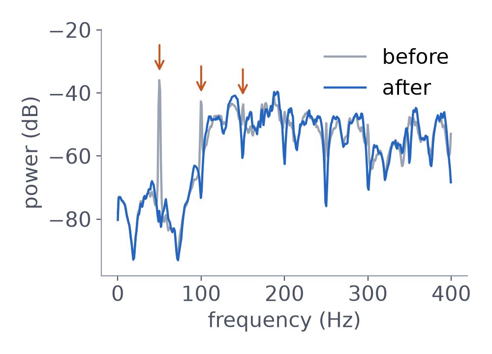
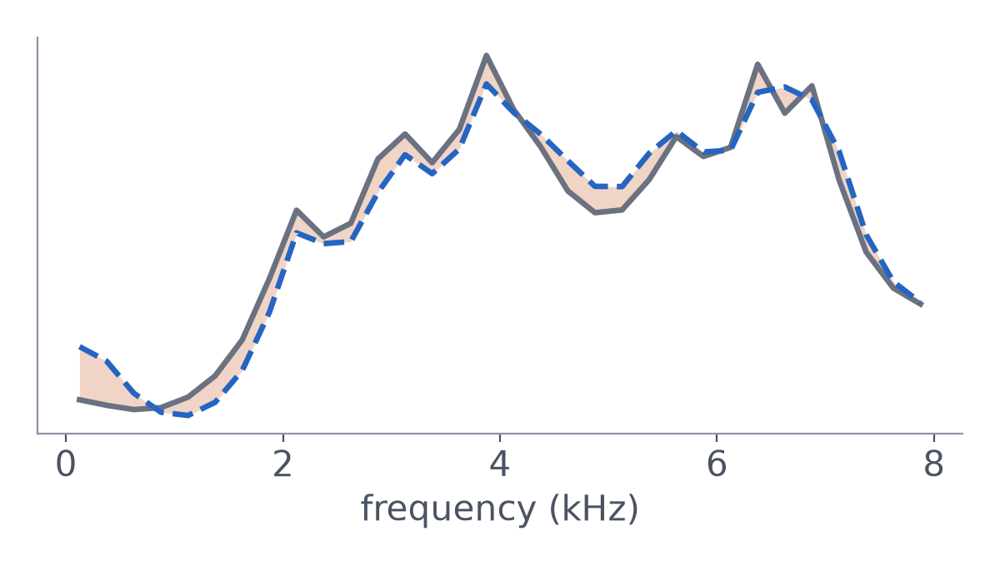
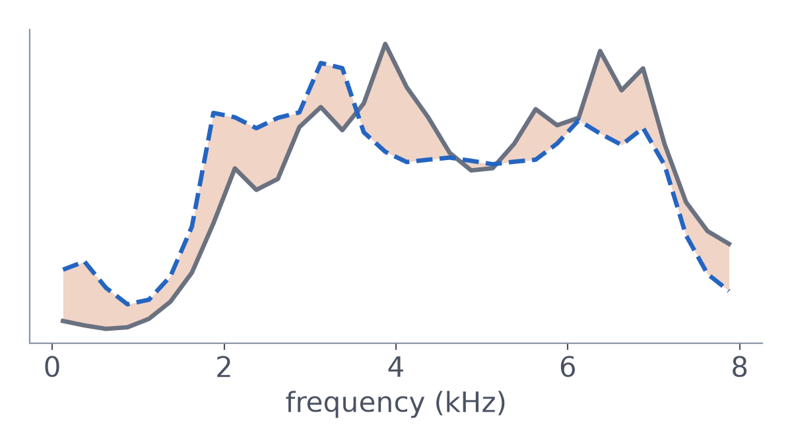
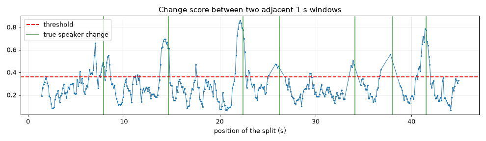

# Real-time Speaker Diarization using Signal Processing

**Who spoke when, live from one microphone — using only signal processing.** The system listens to a conversation of
1–4 people, cuts the audio into speaker turns as they happen, labels each turn (`SPK_1`, `SPK_2`, …) and writes every
turn out as a cleaned `.wav` plus a JSON log, ready to hand to a speech recognizer. 

**Live demo:** <https://multi-speaker-classification-using.vercel.app> (the same Python package, running in the
browser through Pyodide)


| | Synthetic test set | CALLHOME (phone calls) | AMI (meetings) |
|---|---|---|---|
| **DER** (lower is better) | **16.9 %** | 34.9 % | 68.3 % |
| Speaker F1 | 80.7 % | 42.9 % | 27.5 % |
| Max delay after a turn ends | 1.38 s | 1.54 s | 1.43 s |


Course project for *01204496 Algorithmic-Oriented Digital Signal Processing*, Kasetsart University.

---

## Contents

- [Quick start](#quick-start)
- [How it works](#how-it-works)
- [Data and evaluation](#data-and-evaluation)
- [Repository layout](#repository-layout)
- [Limitations](#limitations)

## Quick start

```bash
python3.12 -m venv .venv && .venv/bin/pip install -r requirements.txt
```

**Live from the microphone** (Ctrl+C to stop). On macOS, allow Terminal to use the microphone the first time.
`main.py devices` lists the input devices; pick one with `--device <index>`.

```bash
python main.py live --out runs/live
```

**From a file**, fed in 50 ms blocks like a real microphone (same code path), with evaluation and plots:

```bash
python main.py file data/test4.wav --ref data/test4.rttm --out runs/test4 --plot
```

**Web demo locally** (microphone, sample conversations or an uploaded file), then open `http://localhost:8765/web/`:

```bash
python3 web/serve.py
```

All parameters live in [diarize/config.py](diarize/config.py) and can be overridden with
`--set name=value`, e.g. `--set min_silence_s=0.4 dict_change_thr=0.4`.

### Output

```
runs/<name>/
  result.json                                  # one entry per speaker turn
  result.rttm                                  # standard format, for pyannote.metrics
  segments/0003_SPK_2_00012.40-00015.93.wav    # one file per turn, 16 kHz, cleaned
  eval.json, session.png, session_timeline.png # with --ref / --plot
```

```json
{"id": 0, "speaker": 0, "label": "SPK_1", "start": 0.821, "end": 3.631, "duration": 2.81,
 "confidence": 1.0, "f0_hz": 189.4, "reason": "change", "emitted_at": 4.9, "latency_s": 1.278,
 "file": "segments/0000_SPK_1_00000.82-00003.63.wav"}
```

`reason` is why the turn was cut: `pause` (silence ≥ 0.3 s), `change` (speaker change mid-speech), `max` (longer
than 20 s) or `flush` (recording stopped).

## How it works

Audio arrives at 48 kHz in 50 ms blocks and goes through four stages.

| Stage | Block | What it does | Why | Code |
|---|---|---|---|---|
| **1 · Preprocessing** | FIR low-pass | Kaiser-window low-pass, 147 taps, cut-off 8 kHz | Removes everything above 8 kHz so down-sampling does not alias | [dsp.py](diarize/dsp.py) `kaiser_lowpass` |
| | Down-sample ↓3 | Keeps every 3rd sample: 48 → 16 kHz | Speech needs only 0–8 kHz; 3× less data to process in real time | `Decimator` |
| | NLMS canceller | Adaptive FIR, 1024 taps | Removes periodic noise such as 50 Hz mains hum and fans | `AdaptiveNoiseCanceller` |
| **2 · Feature extraction** | 2.1 Spectrum | Pre-emphasis → Hamming 32 ms → AR(16) model → 32-point spectral envelope | Describes the shape of the vocal tract, which differs from person to person | [sparse.py](diarize/sparse.py) `envelope` |
| | 2.2 Pitch (F0) | Butterworth band-pass 60–900 Hz → center clipping → autocorrelation peak | Measures how high the voice is; separates low and high voices | [dsp.py](diarize/dsp.py) `pitch_autocorr` |
| | 2.3 VAD | Butterworth high-pass 70 Hz → frame energy above the noise floor → median filter | Tells whether anyone is talking, so silences can be found | [vad.py](diarize/vad.py) |
| **3 · Segmentation** | Real-time window | Cuts at a pause ≥ 0.3 s, or mid-speech when the voice changes | Splits the stream into turns of one speaker each, as they happen | [pipeline.py](diarize/pipeline.py) |
| **4 · Speaker ID & output** | Dictionary per speaker | Compares a turn with every known speaker's dictionary; the best fit wins | Gives each turn a label (`SPK_1`, `SPK_2`, …) without knowing anyone in advance | [sparse.py](diarize/sparse.py), [cluster.py](diarize/cluster.py) |
| | Cleaner | Wiener filter | Lowers the background noise before the audio goes to speech recognition | [cleaner.py](diarize/cleaner.py) |
| | Writer | One `.wav` per turn + JSON / RTTM | The output for the next system (ASR) and for evaluation | [io.py](diarize/io.py) |

Spectrum (2.1) and pitch (2.2) both describe *who* is speaking and are used together; VAD (2.3) only says *whether*
anyone is speaking.

### NLMS noise canceller

Mains hum repeats itself every 20 ms, while speech does not. The canceller compares the microphone with its own signal
from 30 ms earlier, learns the part that keeps repeating, and subtracts it. It only learns while nobody is talking, so
it does not start removing the voice.



*Spectrum before (grey) and after (blue) the canceller on a file with added hum: the peaks at 50, 100 and 150 Hz
disappear, the speech is unchanged.*

### Speaker model: sparse coding with a learned dictionary

Each speaker has a small dictionary of 16 spectral-envelope shapes ("atoms"), learned from their own speech with
K-SVD. To check a new turn, every frame is rebuilt from the closest atom of each speaker (OMP). What cannot be rebuilt
is the **residual**: small means the voice fits that speaker. The speaker with the lowest residual (plus a small
penalty for a different average pitch) gets the turn; if nobody fits well enough, a new speaker is created (up to 4).

| Own dictionary (Samantha): 5 % left over | Another speaker's dictionary (Daniel): 35 % left over |
|---|---|
|  |  |

*Grey: a frame of Samantha's voice. Dashed blue: the closest atom. Orange: the residual.*

### Real-time segmentation

Every 10 ms the system decides whether the current turn has ended:

1. **Pause** — 0.3 s of silence closes the turn immediately.
2. **Known speaker takes over** — every 50 ms the last second is matched against the known speakers; when the best
   match changes and stays changed, the turn is cut.
3. **New speaker** — two adjacent 1 s windows are compared; when they clearly sound like different people, the
   change score jumps above the threshold and the turn is cut at the peak.



*Change score between two adjacent 1 s windows. Peaks above the red threshold are cuts; green lines are the true
speaker changes.*

Every turn is emitted within about 1.5 s after it ends.

## Data and evaluation

| Set | What | Used for |
|---|---|---|
| Synthetic | Conversations made from macOS TTS voices, ~100 s each, 20–24 turns, white Gaussian noise + room reverb, 30 % of speaker changes without a pause ([make_conversation.py](tools/make_conversation.py)). `conv2–4` for tuning, `test2–4` (other voices) for testing | Main results |
| Synthetic + hum | The six synthetic files plus 50 Hz mains hum with harmonics up to 600 Hz (amplitude 1/k) at several levels | NLMS canceller |
| CALLHOME | English phone calls, 2–3 speakers, ~9 % overlapped speech; first 10 calls of Hugging Face `talkbank/callhome` (76 min) | Real data, not tuned on |
| AMI | Meetings ES2004a, IS1009a, TS3003a, headset mix, 4 speakers, 5–16 % overlap (57 min) | Real data, not tuned on |

Only the reference `.rttm` files of the synthetic set are in the repository; the audio is generated with
`tools/make_conversation.py`, and CALLHOME / AMI must be downloaded separately into `data/callhome/` and `data/ami/`.

**DER** (diarization error rate) = (missed speech + false alarm + speaker confusion) / total speech, after mapping
system labels to true speakers in the best way and ignoring ±0.25 s around each boundary. **Speaker F1** is averaged
per speaker, so one talkative person cannot dominate it.

## Repository layout

```
diarize/            the package
  config.py         every parameter
  pipeline.py       StreamingDiarizer: real-time window, segmentation
  frontend.py       stages 1–2: preprocessing and the three feature branches
  dsp.py            FIR / IIR / NLMS / windows / autocorrelation / pitch
  ar.py, sparse.py  AR envelope, K-SVD + OMP speaker model, change score
  vad.py            energy VAD
  cluster.py        speaker assignment and merging
  cleaner.py        Wiener filter
  evaluate.py       DER, speaker F1
main.py             command line: live / file / eval / devices
tools/              data generation, tuning and experiments
web/                browser demo (Pyodide), deployed on Vercel
tests/              unit tests (python -m pytest tests)
docs/               pipeline diagram and README images
pipeline.ipynb      step-by-step notebook of every block
```

Useful tools:

```bash
.venv/bin/python tools/make_conversation.py --speakers 3 --turns 20 --out data/conv3   # new synthetic conversation
.venv/bin/python tools/tune.py data/conv2 data/conv3 data/conv4 --grid dict_change_thr=0.3,0.36,0.42
.venv/bin/python tools/hum_test.py data/test2 data/test3 data/test4 --snr 20 10 0
.venv/bin/python tools/experiments.py                                              # all results
```

## Limitations

- **Overlapping speech** is not modeled; it is the main reason for the poor AMI result.
- **Thresholds are sensitive.** The change threshold matters most, and a small change can move one file's DER by
  10–20 points. Values were tuned on synthetic TTS voices, which are far more stable than real people; for a real room,
  record with `main.py live` (it keeps `recording.wav`), make a reference RTTM and re-tune with `tools/tune.py`.
- **Extra speakers.** The system often opens one speaker too many (4 found on four of the six synthetic files).
- **Short turns.** A new person needs ≥ 1.5 s of speech before a new speaker is opened; until then their speech goes
  to the closest known speaker.
- **No going back.** Labels already emitted are never changed (it is real-time). If two speakers are merged later,
  only new turns get the merged label.
- **Quiet speakers** can be missed by the energy VAD.

An earlier version used MFCCs with a Gaussian per speaker (ΔBIC), which is not course material. It is still in
[gauss.py](diarize/gauss.py) and can be run with
`--set speaker_model=gauss aa_window=hamming vad_median=0 clean_method=subtract`.
